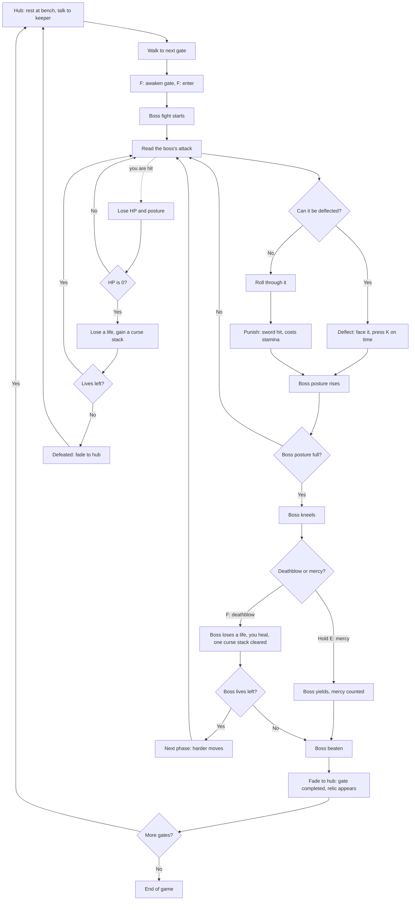

# Soul Rush: gameplay specification

A 2D boss-rush action game (GDevelop 5). You fight a string of bosses, one gate at a time, from a ruined cathedral hub. The fights borrow from two games. From Sekiro comes the posture system: you win by deflecting attacks to break a boss's posture and landing a deathblow, not by chipping its health bar down. The point of that design is fast, reactive combat, where staying on the boss and deflecting beats the classic hit-and-run loop of striking once and backing off to reset. From Bloodborne comes the rally system: damage you take can be won back by hitting the enemy straight away (25% of the damage taken in the last 2.5 seconds per hit), so pressing the attack is also the way to recover. Together they reward aggression and reaction over retreat. Numbers come from the project's balance notes and are set by reading the combat rules, so not all of them are playtested yet.

## 1. Rules and mechanics

### Controls

| Action | Key |
| --- | --- |
| Move | A / D (run) |
| Attack (sword combo) | J or left mouse |
| Deflect | K or right mouse |
| Roll (dodge, invulnerable while rolling) | Space |
| Lunge (a long dash attack) | Q |
| Deathblow on a posture-broken boss | F |
| Spare a boss at its last stun | hold E |
| Interact in the hub (gates, bench, keeper, lectern) | F |

### Combat rules

- **Health and lives.** The player has 100 HP and 5 lives. Bosses have 2 or 3 lives, each with its own health bar.
- **Posture.** Every character has a posture bar. Enemy hits fill the player's posture. At 100 the player is
  stunned for 2 s and can be hit but cannot act. Posture drains when you are not being hit.
- **Deflect.** Raise the sword just as a hit lands: no damage, and the boss's posture rises by 14. The window is short
  and **directional**: you must face the attack. A few attacks cannot be deflected (the grab, the Samurai's
  Judgement Cut) and are rolled instead. A failed deflect has a cooldown.
- **Breaking posture.** A boss's posture is 70 to 80. A sword hit adds 5, a deflect adds 14. At the maximum the boss
  kneels, stunned for 2.5 to 3 s. Deflecting is the fast route. A boss's posture drains faster while it is healthy
  and slower when it is hurt, so pressure pays off more as it weakens.
- **Deathblow (F).** On a kneeling boss, F takes a whole life, heals the player (a crimson glow) and clears one
  curse stack. The other way to take a life is to chip the health to 0 (slow).
- **Stamina.** 100 stamina. A swing costs 15, a roll 30, a lunge 50. It refills at 20 a second after 1.2 s of rest.
  Attacking costs rolls, so you cannot mash.
- **Rally.** Hitting an enemy gives back 25% of the damage you took in the last 2.5 s.
- **Curse.** Each time you die on a life you gain one curse stack (up to 3): max HP drops 15% per stack and the
  curse icon (a flame) shows it. A deathblow removes one stack. On your last life with all stacks, *Desperation*
  gives you more timing room.
- **Fixed timings.** Boss patterns are never randomised, so you can learn them (a deliberate design call).
- **Rooted.** A player caught in a snare cannot attack, only deflect.

## 2. Goals and end states

- **Win a fight:** take all of the boss's lives (deathblows or health), or **spare** it with the merciful ending.
  Either way the boss is marked beaten, you fade back to the hub, the gate shows its completed art and a relic
  appears on its plinth.
- **Lose a life:** the HP bar empties, you gain a curse stack, and the fight continues with lower max HP.
- **Lose the fight:** lose your last life. You fade out and return to the hub to try the gate again.
- **Win the game:** beat every boss gate. (The ending hook is still being designed. There is no end screen yet.)
- Progress is saved in the browser (`SoulRush.progress`). The hub bench has a "Start over" option that wipes it.

### Mercy

Hold E at a boss's last kneel (7 s window) to spare it instead of the deathblow. Each boss has its own farewell:

- Samurai: he stands, bows, the player nods, and he bursts into petals.
- Gunslinger: a text exchange in binary ("friend?", "...", "friend!").
- Bladekeeper: a duel salute, one clink of the blades, she lowers her guard.
- Leaf Ranger: a volley of three arrows that bloom, then he dissolves into leaves.

Sparing sets a per-boss flag. The number of flags is a hidden mercy counter. The Cat has a hidden ending of its own:
don't attack, sit down, and pet it.

## 3. Resources, objects and items

| Resource | Role |
| --- | --- |
| HP (per life) | The health bar. 100 at full, less per curse stack. |
| Lives | 5, each lost life costs a curse stack. |
| Stamina | Pays for swings, rolls and lunges. |
| Posture | The core resource: the player's is a second health bar, the boss's is the way to win. |
| Curse stacks | Shown as flames. A penalty to max HP, cleared by deathblows. |
| Hub objects | Bench (rest or start over), keeper (talk, ask for training), lectern (lore), boss gates, trophy plinths (relics earned by wins), hearth and braziers. |

Not built yet: tools (spammable, limited by a currency, not by curse stacks) and boss-dropped abilities (the Cat as
an ability is planned).

## 4. NPCs and enemies

| Who | Lives, HP | What the fight is about |
| --- | --- | --- |
| **Samurai** (cherry blossom arena) | 3 lives, 200 HP | Phase 1: quickdraw swings, single and triple cuts, grabs, petal casts. Phase 2: he dashes through you, so you turn to deflect. Phase 3: mirror images, afterimages, tornado, petal waves, and the Thousand Cuts finisher. Dodges your hits (more often as the fight goes on). A flawless fight earns a hidden petal ending. Attacking him during his prayer starts him in phase 2. |
| **Leaf Ranger** (Deep Forest) | 2 lives, 200 HP | A ranged fight: arrows, arrow rain, snares, a thorn wall, the Bramble Grasp, a beam. In phase 2 he leaps to a perch and fires lasers, and only a deflected laser brings him down. |
| **Gunslinger** (moonlit desert) | 600 HP | Bullets, shotgun and grenades. A fight by another team member, tuned on its own numbers. |
| **Cat** | 3 lives, 120 HP | A fast, reading-heavy fight in short strings: swipes, pounce, zoomies, burrow, claw flurry, maul. |
| **Bladekeeper** | 2 lives, 200 HP | A close duelist: combos, a guard that punishes mashing, then traps and a blade garden. |
| **Fire Knight** | not built yet | The gate is locked. |
| **Keeper** | NPC in the hub | Talks, and offers the training fight. |

## 5. Unlockable abilities

- **Hub gates.** They open one at a time in order: Samurai, Leaf Ranger, Gunslinger, Bladekeeper, Cat. F at the next
  gate wakes it with a short cutscene, F again enters.
- **Relics** on the hub plinths, one per boss beaten.
- **Planned:** the Cat as an ability, boss-dropped tools, and curse abilities (deflecting roll-only attacks, a delayed
  shadow of the player, cursed-only content). The mercy counter drives the story ending.

---

## 6. Core loop

The loop has two nested parts: the long loop (the hub) and the short loop (one fight).

### Long loop (hub to fight to hub)

1. Rest in the hub: use the bench, talk to the keeper, read the lectern.
2. Go to the next gate, press F to awaken it, press F to enter.
3. Fight the boss (the short loop below).
4. Fight ends. Either you **win** (the boss is killed or spared) or you **lose** (your last life is lost).
5. Fade back to the hub. On a win the gate shows its completed art, a relic appears, and the next gate becomes
   available. On a loss you start again at step 1 with the same gate.
6. When no gates remain, the game ends.

### Short loop (inside a fight, every few seconds)

1. **Read** the boss's attack from its wind-up (fixed timings, so you learn it).
2. **Respond.** Deflect it (face it, press K at the right time), or roll through it if it cannot be deflected.
3. **Punish.** Hit back with the sword (costs stamina) in the opening after the attack.
4. **Posture builds up** on the boss (deflect +14, hit +5). Your own posture rises when you are hit.
5. **Boss posture full?** Yes: the boss kneels, and the **choice** is the deathblow (F) or mercy (hold E). No: back to step 1.
6. **Lives left on the boss?** Yes: the next phase starts, the boss gets harder, back to step 1. No: the fight is won.
7. **Side branch:** if you take too much damage you lose a life and gain a curse stack, and the fight continues. If you
   lose your last life, the fight is lost and you return to the hub.

### Chart (for draw.io: paste into Arrange > Insert > Advanced > Mermaid)

---

## 7. Progression

The player gets no stat upgrades. Progression is in the hub and the bosses: each boss teaches or demands something
new, and the hub opens one gate at a time.

| Order | Level | Concept | What is new |
| --- | --- | --- | --- |
| 0 | **Tutorial** (a training fight, offered by the keeper) | A gentle Samurai in a step-by-step lesson. | Move, attack, deflect, roll, break posture, deathblow. Boss damage is low on purpose. |
| 1 | **Samurai** | The first real boss, in a cherry blossom arena. Three phases. | Deflecting melee, facing the attack, posture breaks, rolling the grab, the first curse stacks. Phase 3 asks you to turn around to deflect images. |
| 2 | **Leaf Ranger** | A ranged fight in a forest. | Fighting a distant enemy: deflecting arrows, snares that root you, thorn bushes that the sword cuts, chasing him down. The perch needs a deflected laser. |
| 3 | **Gunslinger** | A moonlit desert duel. | Bullets, shotgun blasts, and grenades. (Order set by the team; numbers are the team's own.) |
| 4 | **Bladekeeper** | A close duelist. | A guard that punishes mashing, traps and the blade garden in the second life. |
| 5 | **Cat** | A fast creature in short strings. | Reading short wind-ups, burrow and claw flurries, a hidden mercy ending. |
| 6 | **Fire Knight** | Planned, locked. | Not built yet. |

Across the whole game:

| Layer | What grows |
| --- | --- |
| Hub | Gates open one by one. Gates change to completed art. Relics fill the plinths. Keeper lines change. |
| Bosses | Each boss has 2 or 3 lives, and each new life adds moves. |
| Curse | Raised by dying, lowered by deathblows. Mercy skips a deathblow, so the merciful route is the harder, more cursed one. |
| Story | The mercy counter (how many bosses were spared) decides the ending. Not built yet. |

### Known gaps (be honest in the hand-in)

- No end screen, no ending, and no tools yet.
- The Bladekeeper, Cat and mercy numbers have not been playtested. The Fire Knight does not exist yet.
- Debug keys are still on (one switch, `DEBUG_KEYS`, turns them all off for a release).
