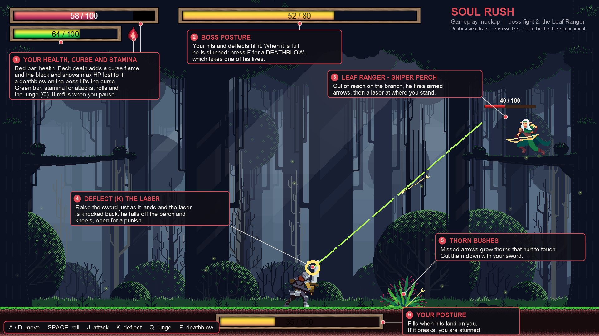

# Soul Rush: gameplay mockup

`soul_rush_mockup.png` is the annotated mockup (1920×1080). `soul_rush_frame_clean.png` is the same moment without labels (1280×720, the game's own resolution). Both are 16:9, like the game. The frame is a real in-game frame from the GDevelop build, posed for the picture.

## Gameplay explanation

Soul Rush is a 2D boss-rush action game in the style of Souls-like duels: every stage is a one-on-one fight against a boss in a single-screen arena. The core loop is to learn the boss's fixed attack pattern and answer it: roll through attacks, deflect them by raising the sword at the last moment, and strike back in the openings. Your hits and deflects fill the boss's posture bar, and when it is full he is stunned and a deathblow (F) takes one of his lives. Getting hit costs health and fills your own posture, and each death adds a curse that lowers your maximum health until your next deathblow, so careful play is rewarded and careless play snowballs. The mockup shows the second boss, the Leaf Ranger, perched on a branch out of sword range: the only way to bring him down is to deflect his laser, which knocks him off and leaves him kneeling, open for a punish.

## What the mockup shows

1. **Your health, curse and stamina** (top left): health with the curse's lost maximum shown in black, one curse flame, and stamina.
2. **Boss posture** (top centre).
3. **The Leaf Ranger on his sniper perch**, with his health above him.
4. **A deflect**: the laser meets the raised sword.
5. **Thorn bushes**, which grow where his arrows land.
6. **Your posture** (bottom centre).

The controls are along the bottom: A/D move, Space roll, J attack, K deflect, Q lunge, F deathblow.

## Asset credits (borrowed art in the mockup)

| Asset | Source | Licence notes |
|---|---|---|
| Forest background | *Free Pixel Art Forest* by Eder Muniz, https://edermunizz.itch.io/ | Free pack, see its `license.txt` |
| Player knight | *Free Knight* (120×80) pack, `FreeKnight_v1` (author: confirm on the pack's itch.io page) | Free pack |
| Leaf Ranger boss | *Elementals: Leaf Ranger* free pack, `Elementals_Leaf_ranger_Free_v1.0` (author: confirm on the pack's itch.io page) | Free pack |
| Floor tiles | *Tile Set Nature* (`Cenario.png`) (author: confirm) | Free pack |
| Wooden bars (health, stamina, posture) | GDevelop asset store, *Panel Sprite Continuous Bar* (Wood bars) | GDevelop asset store |
| Sniper perch branches, curse flame, slim boss health bar | Made for Soul Rush | — |
